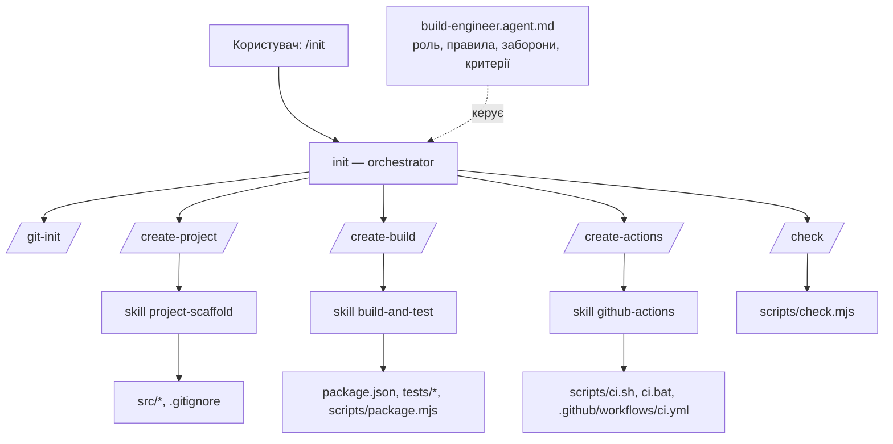

# Архітектура AI-агента build-engineer

## 1. Яку проблему вирішує агент
Створення навіть мінімального кросплатформного проєкту вимагає низки
повторюваних кроків: структура каталогів, `.gitignore`, конфігурація
TypeScript, система складання, тести, упаковка виконуваного файлу, CI для трьох
ОС. Агент формалізує ці кроки у вигляді skills і commands, виконує їх у
фіксованому порядку і **сам перевіряє результат**, тому:
- результат відтворюваний (повторний запуск дає ті самі файли);
- помилки виявляються одразу на тому кроці, де вони виникли;
- неможливо «забути» тест, ОС у матриці CI або додати `dist/` до Git.

## 2. Компоненти

| Компонент | Тип | Файл | Відповідальність |
|---|---|---|---|
| build-engineer | Agent manifest | `.github/agents/build-engineer.agent.md` | Роль, параметри варіанту, межі відповідальності, правила роботи з файлами, заборонені дії, критерії завершення |
| project-scaffold | Skill | `.github/skills/project-scaffold/SKILL.md` | Структура проєкту, `Hello World`, `.gitignore` |
| build-and-test | Skill | `.github/skills/build-and-test/SKILL.md` | npm scripts, TypeScript, Vitest, `BasicAddition`, виконуваний файл |
| github-actions | Skill | `.github/skills/github-actions/SKILL.md` | `ci.sh`, `ci.bat`, `ci.yml` з матрицею ОС |
| git-init | Command | `.github/prompts/git-init.prompt.md` | Перевірка репозиторію, `.gitignore`, стан Git |
| create-project | Command | `.github/prompts/create-project.prompt.md` | Виклик `project-scaffold` |
| create-build | Command | `.github/prompts/create-build.prompt.md` | Виклик `build-and-test`, складання і тести |
| create-actions | Command | `.github/prompts/create-actions.prompt.md` | Виклик `github-actions` |
| check | Command | `.github/prompts/check.prompt.md` | Перевірка без змін проєкту (`scripts/check.mjs`) |
| init | Orchestrator | `.github/prompts/init.prompt.md` | Послідовний запуск команд, зупинка при помилці |

## 3. Дані, що передаються між етапами
| Етап | Вхід | Вихід → наступному етапу |
|---|---|---|
| git-init | робочий каталог | валідний Git-репозиторій, `.gitignore` |
| create-project | `language`, `projectName` | `src/hello.ts`, `src/greeting.ts`, `src/math.ts` |
| create-build | вихідні файли, `nodeVersion`, `testName` | `package.json`/lock, результати тестів, `bin/hello` |
| create-actions | npm scripts, список ОС | `scripts/ci.*`, `.github/workflows/ci.yml` |
| check | усі файли | вердикт `CHECK PASSED` / список помилок |

## 4. Обробка помилок оркестратором
1. Перед кожним кроком виводиться `== init: step n/5 <command>`.
2. Кожна команда має розділ **Verification**; якщо він не виконується —
   оркестратор зупиняється і виводить `init STOPPED at step n/5 ...` з кодом
   помилки зі skill (`E-SCAFFOLD-*`, `E-BUILD-*`, `E-TEST-*`, `E-CI-*`).
3. Наступні кроки не виконуються, успіх не повідомляється.
4. Фінальний крок `check` запускає `scripts/check.mjs`, який повертає
   ненульовий код завершення, якщо хоча б одна перевірка не пройшла.
5. Ідемпотентність: усі команди спершу перевіряють наявність файлу та його
   вміст, тому повторний `init` не змінює проєкт.

## 5. Відповідність рекомендованій структурі
GitHub Copilot у VS Code використовує саме ці каталоги, тому структура
відповідає методичці. Відмінності:

| Методичка | У проєкті | Причина |
|---|---|---|
| `CMakeLists.txt` | `package.json`, `tsconfig.json`, `vitest.config.ts` | варіант 6 — TypeScript + npm scripts |
| виконуваний файл `hello` (CMake) | `bin/hello` / `bin/hello.exe` | створюється через Node.js Single Executable Applications (`scripts/package.mjs`) |
| каталог `build/` | `dist/`, `build/`, `bin/` | усі три ігноруються Git |
| — | `scripts/check.mjs` | реалізація команди `check`, щоб перевірка була детермінованою |
| — | `docs/ai-log.md` | журнал взаємодії з AI |

## 6. Обмеження агента
- Підтримує лише TypeScript (варіант 6); інша мова → помилка `E-SCAFFOLD-LANG`.
- Не виконує коміти та push — це робить студент після перегляду змін.
- Перевірка CI на GitHub можлива лише після push (локально перевіряється
  структура workflow і той самий CI-скрипт).
